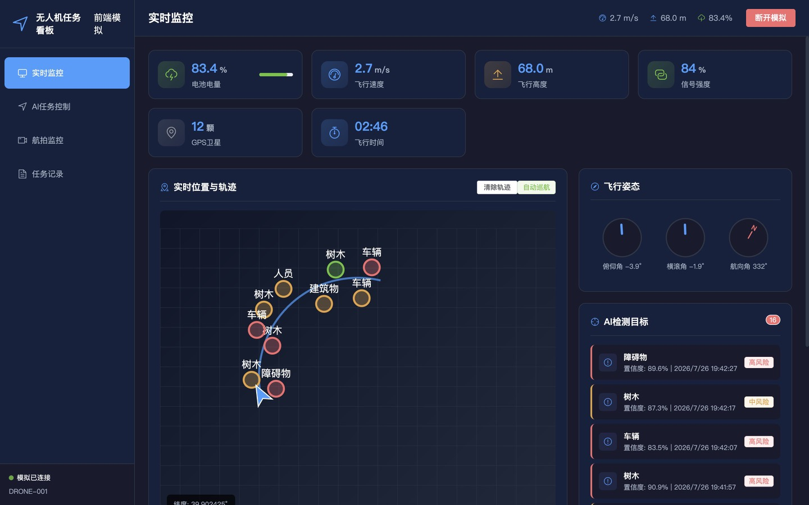
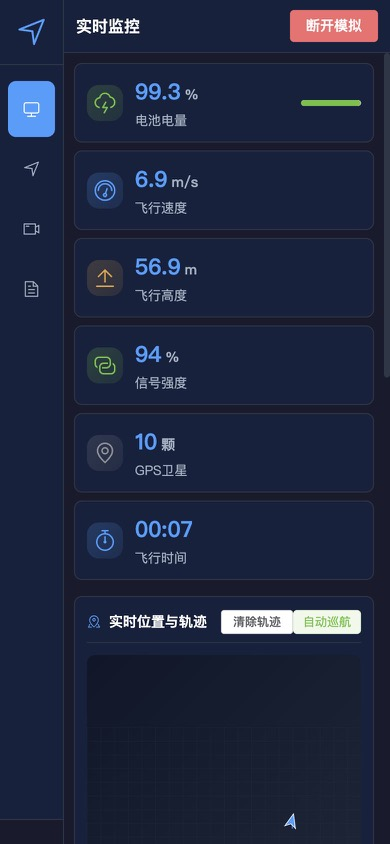

# AI辅助无人机实时监控与任务控制系统

中文 | [English](#ai-assisted-drone-real-time-monitoring-and-mission-control-system)

[](https://github.com/dongtingshuo/vue-drone-mission-dashboard/actions/workflows/ci.yml)
[](package.json)
[](LICENSE)

一个基于 Vue 3 + Vite 的无人机任务控制前端项目，面向巡检、安防、农田监测等场景，提供实时飞行状态、航点规划、航拍识别和任务记录管理等工作台能力。

> 当前版本使用前端模拟数据演示完整交互流程，可作为无人机地面站、低空巡检平台或可视化大屏的前端原型继续扩展。

| 桌面端实时监控 | 移动端适配 |
| --- | --- |
|  |  |

## 项目亮点

- 深色调控制台界面，适合实时监控和数据密集场景。
- 连接无人机后自动生成模拟飞行数据，展示电量、速度、高度、姿态、轨迹和信号状态。
- 支持航点增删改查、任务参数配置、路径优化和任务保存/发送。
- 内置航拍画面模拟、AI识别标记、手动框选、截图和录制记录。
- 任务记录支持搜索、日期/状态/类型筛选、分页、详情查看、重新执行和 CSV 导出。
- 使用路由懒加载和 Vite 分包配置，降低首屏资源压力。

## 技术栈

| 类型 | 技术 |
| --- | --- |
| 前端框架 | Vue 3 |
| 构建工具 | Vite |
| 状态管理 | Pinia |
| 路由 | Vue Router |
| UI 组件 | Element Plus |
| 图表 | ECharts / vue-echarts |
| 数据导出 | 浏览器原生 CSV / JSON 下载 |

## 功能模块

| 模块 | 说明 |
| --- | --- |
| 实时监控 | 展示无人机在线状态、飞行指标、姿态仪表、轨迹地图和 AI 检测目标。 |
| AI任务控制 | 进行任务配置、航点编辑、路径优化、任务保存与发送。 |
| 航拍监控 | 模拟实时航拍画面，支持目标识别标记、截图、录制和自动检测。 |
| 任务记录 | 管理历史任务，支持筛选、分页、CSV/JSON 导出、详情查看、删除和重新执行。 |

## 快速开始

### 环境要求

- Node.js >= 20.19.0
- npm >= 10.0.0

### 安装与运行

```bash
npm install
npm run dev
```

开发服务器启动后，打开终端提示的本地地址即可访问。

### 常用命令

```bash
npm run dev      # 启动开发服务器
npm run build    # 构建生产版本
npm run preview  # 本地预览生产构建
npm run lint     # 执行 Vue/JavaScript 静态检查
npm run check    # 执行静态检查与生产构建
npm run audit    # 检查生产依赖安全公告
```

## 项目结构

```text
vue-drone-mission-dashboard/
├── .github/workflows/ci.yml  # GitHub Actions 构建检查
├── public/                   # 静态资源
├── src/
│   ├── layout/               # 主布局
│   ├── router/               # 路由配置
│   ├── stores/               # Pinia 状态管理
│   ├── views/                # 页面视图
│   ├── App.vue
│   ├── main.js
│   └── style.css
├── index.html
├── package.json
├── STRUCTURE.md
└── vite.config.js
```

更多结构说明见 [STRUCTURE.md](./STRUCTURE.md)。

## 数据说明

项目目前未连接真实无人机、后端服务或 AI 推理服务。实时飞行数据、航拍识别结果和任务记录均在前端模拟生成，便于展示页面交互和业务流程。

后续接入真实服务时，可将 Pinia store 中的模拟更新逻辑替换为 WebSocket、REST API 或设备 SDK 数据源。

所有状态仅保存在当前页面内存中，刷新页面后会恢复初始模拟数据；“录制”只生成录制元数据，并不保存真实视频文件。航拍截图来自页面内的模拟场景。导出的 CSV 会防护常见电子表格公式注入，详情报告则以 JSON 导出并明确标记数据源为前端模拟。

## 部署建议

构建静态资源：

```bash
npm run build
```

生成的 `dist/` 目录使用相对资源路径和 Hash 路由，可部署到 GitHub Pages 项目子路径、Vercel、Netlify 或任意静态站点服务。

## 安全与限制

- 本项目不会向真实飞行器发送指令，不应作为真实地面站或安全关键系统使用。
- 正式接入设备前必须增加身份认证、授权、命令确认、遥测完整性校验、失联保护、地理围栏、审计日志和服务端验证。
- 详见 [SECURITY.md](./SECURITY.md)。

---

# AI-Assisted Drone Real-Time Monitoring and Mission Control System

[中文](#ai辅助无人机实时监控与任务控制系统) | English

A Vue 3 + Vite frontend project for drone mission control scenarios such as inspection, security patrol, and agricultural monitoring. It provides a dashboard-style workspace for real-time flight status, waypoint planning, aerial recognition, and mission record management.

> The current version uses simulated frontend data to demonstrate the full interaction flow. It can be extended into a drone ground station, low-altitude inspection platform, or visualization dashboard prototype.

## Highlights

- Dark control-console interface designed for real-time monitoring and data-dense workflows.
- Simulated drone connection with live battery, speed, altitude, attitude, trajectory, and signal data.
- Waypoint CRUD, mission parameter configuration, path optimization, and mission save/dispatch flows.
- Simulated aerial video, AI recognition marks, manual selection, screenshots, and recording records.
- Mission search, date/status/type filtering, pagination, detail view, re-execution, deletion, and CSV export.
- Route lazy loading and Vite chunk splitting for a cleaner production build.

## Tech Stack

| Category | Technology |
| --- | --- |
| Frontend Framework | Vue 3 |
| Build Tool | Vite |
| State Management | Pinia |
| Router | Vue Router |
| UI Library | Element Plus |
| Charts | ECharts / vue-echarts |
| Data Export | Native browser CSV / JSON downloads |

## Features

| Module | Description |
| --- | --- |
| Real-Time Monitoring | Displays drone online status, flight metrics, attitude panel, trajectory map, and AI detection targets. |
| AI Mission Control | Edits mission parameters and waypoints, optimizes routes, and saves or dispatches missions. |
| Aerial Monitoring | Simulates an aerial video feed with target recognition marks, screenshots, recording, and automatic detection. |
| Mission Records | Manages historical missions with filtering, pagination, CSV/JSON export, detail view, deletion, and re-execution. |

## Getting Started

### Requirements

- Node.js >= 20.19.0
- npm >= 10.0.0

### Installation

```bash
npm install
npm run dev
```

After the development server starts, open the local URL shown in the terminal.

### Scripts

```bash
npm run dev      # Start the development server
npm run build    # Build for production
npm run preview  # Preview the production build locally
npm run lint     # Lint Vue and JavaScript sources
npm run check    # Lint and build for production
npm run audit    # Check production dependency advisories
```

## Project Structure

```text
vue-drone-mission-dashboard/
├── .github/workflows/ci.yml  # GitHub Actions build check
├── public/                   # Static assets
├── src/
│   ├── layout/               # Main layout
│   ├── router/               # Router configuration
│   ├── stores/               # Pinia state management
│   ├── views/                # Page views
│   ├── App.vue
│   ├── main.js
│   └── style.css
├── index.html
├── package.json
├── STRUCTURE.md
└── vite.config.js
```

See [STRUCTURE.md](./STRUCTURE.md) for more architectural details.

## Data Notes

This project is not connected to real drones, backend services, or AI inference services yet. Real-time flight data, aerial recognition results, and mission records are generated in the frontend to demonstrate the user flow.

When integrating real services later, the simulated update logic in the Pinia store can be replaced with WebSocket, REST API, or device SDK data sources.

All state is held in page memory and resets to the initial simulation after a reload. “Recording” stores metadata only; it does not create a real video file. Aerial screenshots are rendered from the simulated scene. CSV exports mitigate common spreadsheet-formula injection, while detail reports are exported as JSON and identify the source as frontend simulation.

## Deployment

Build static assets:

```bash
npm run build
```

The generated `dist/` directory uses relative asset paths and hash routing, so it can be deployed under a GitHub Pages project path, Vercel, Netlify, or another static host.

## Safety and limitations

- This project does not send commands to a real aircraft and must not be used as a production ground station or safety-critical system.
- A real integration requires authentication, authorization, command confirmation, telemetry integrity checks, link-loss protection, geofencing, audit logs, and server-side validation.
- See [SECURITY.md](./SECURITY.md).
